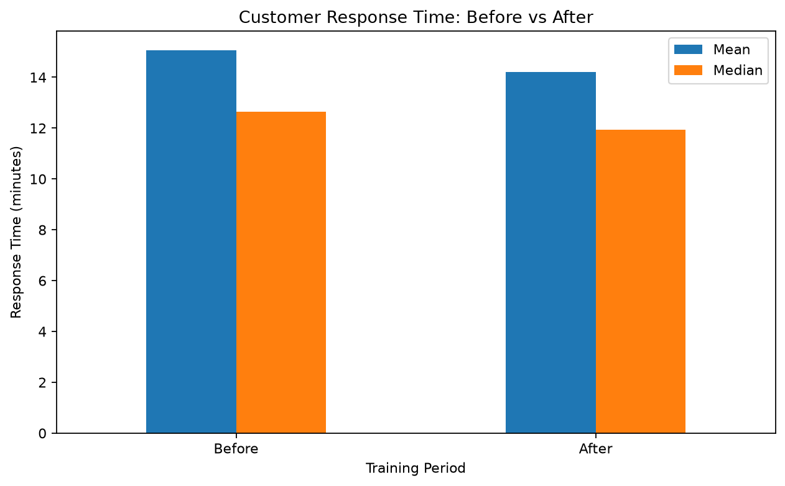
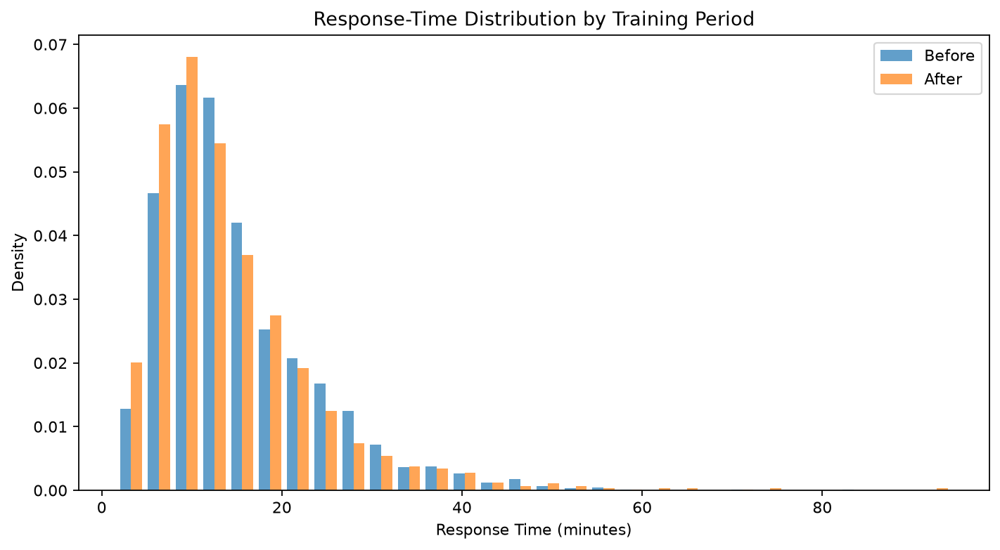
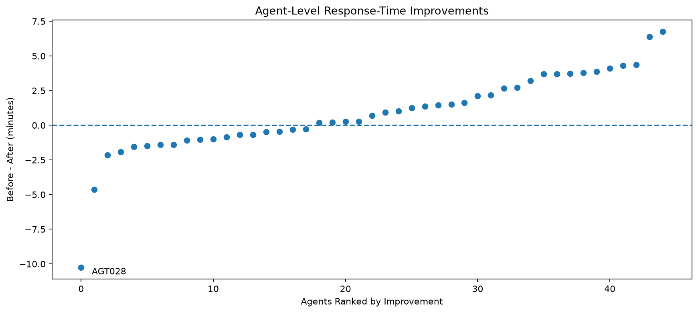
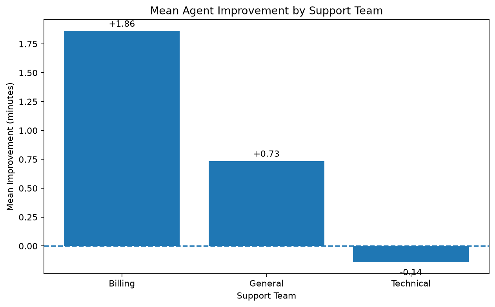
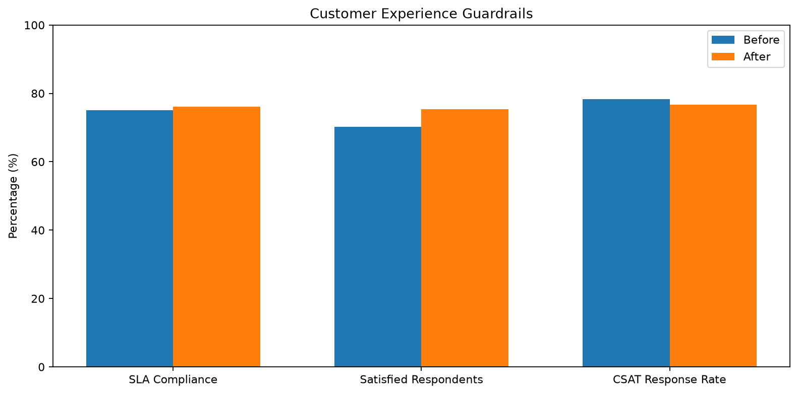

# Customer Support Hypothesis Testing & Operational Improvement

**Project 07 · Business Analyst & Applied Statistics Portfolio · Python / Jupyter**

> **Synthetic case study.** All 4,150 support tickets and 45 agents were simulated with a fixed random seed. No real company or employee was evaluated. This is a before-and-after observational analysis, **not** a randomized A/B test or causal proof that training worked.

## Executive overview

A fictional support operation introduced a training program intended to improve first-response speed, prioritization, routing, and customer communication. We evaluated **2,050 pre-training** and **2,100 post-training** tickets across the **same 45 agents** in three teams: Billing, General, and Technical (15 agents each).

**Decision:** Continue training on a **conditional, monitored basis** rather than declare effectiveness or expand it uncritically. Prioritize high-priority SLA breaches, Technical Support, and case-mix-adjusted resolution-time monitoring. Plan a controlled or staggered follow-up evaluation before making causal claims.

### Business KPI scorecard

| KPI | Before | After | Observed change |
|---|---:|---:|---:|
| Tickets | 2,050 | 2,100 | +50 (+2.44%) |
| Ticket-weighted mean first response | 15.06 min | 14.22 min | −0.84 min (−5.57%) |
| Median first response | 12.65 min | 11.94 min | −0.71 min |
| Mean resolution time | 124.85 min | 129.05 min | +4.20 min |
| SLA compliance | 75.02% | 76.14% | +1.12 percentage points |
| Mean CSAT, among respondents | 3.97 / 5 | 4.04 / 5 | +0.07 points |
| Satisfied respondents (CSAT 4–5) | 70.30% | 75.42% | +5.12 pp |
| CSAT response rate | 78.34% | 76.71% | −1.63 pp |
| High-priority ticket share | 21.71% | 28.05% | +6.34 pp |
| Complex ticket share | 20.88% | 27.76% | +6.88 pp |

**Interpretation:** Faster first responses coincided with longer resolution times and a more difficult case mix. Satisfaction improved among people who responded to the survey; nonrespondents' satisfaction remains unknown.

### Statistical evidence

| Investigation | Result | Decision at 5% |
|---|---|---|
| Primary paired t-test, 45 matched agent means | Mean improvement **+0.8186 min**; t(44) = **1.8757**; p = **0.0673**; 95% CI **[−0.0610, +1.6982] min**; paired Cohen's *d*<sub>z</sub> = **0.2796** | Does **not** reject zero mean change |
| One-way ANOVA of agent improvement by team | F(2,42) = **1.8256**; p = **0.1737**; η² = **0.0800** | No established difference among population team means |
| Welch ANOVA, unequal-variance comparison | F ≈ **1.7034**; p = **0.2009** | Same conclusion |
| Exploratory paired sensitivity without AGT028 | 44 agents; mean **+1.0700 min**; p = **0.0054** | **Exploratory only**, does not replace primary test |

**Methods & caveats:** One ticket is one source-data row. The primary *unit of statistical analysis* is the agent: one mean response time before and after, matched by `agent_id`. Ticket-weighted mean improvements and equally weighted agent-level improvements are different estimands. The paired differences departed from normality (Shapiro–Wilk p = 0.0056); AGT028 was influential. The study lacks a contemporaneous control group, and agent outcomes may share team-level influences. Statistical significance is not causality.

### Where management should focus

- **High-priority SLA:** after-period compliance **55.35%**; about **263 of 589** high-priority tickets missed their target.
- **Technical Support:** after-period SLA **64.77%**, mean resolution **167.55 min**, and only **6 of 15 agents** improved.
- **General Support:** first responses became faster, but SLA fell from **85.41% to 82.40%**.
- **Agent AGT028:** response time rose from **17.31 to 27.55 min** while high-priority share rose from **18.00% to 38.46%** and complex share rose from **14.00% to 38.46%**. This is an investigation lead, not an employee-performance verdict.

For detailed evidence, limitations, proposed owners, targets, and an explicitly hypothetical financial scenario, read **[Executive Decision Report](docs/executive_decision_report.md)**.

## Visual evidence











## Reproducibility

**Tools:** Python, Pandas, NumPy, SciPy, statsmodels, Matplotlib, Jupyter, Git. No Power BI, ML model, LLM, or artificial intelligence is claimed in this statistics project.

From the repository folder, on Windows PowerShell:

```powershell
python -m venv .venv
.\.venv\Scripts\Activate.ps1
python -m pip install -r requirements.txt
```

1. Open `notebooks/support_training_analysis.ipynb` in VS Code with the `.venv` kernel, then **Restart Kernel and Run All**. The notebook reads `data/support_tickets.csv` and generates its results and five PNGs.
2. Run the independent verification/export script:

   ```powershell
   python python/finalize_project.py
   ```

   It independently re-reads the CSV with an explicit `%Y-%m-%d` date format, validates 12 business rules, recalculates core tests, cross-checks them against known seed-generated results, exports **`output/statistical_results.csv`**, and confirms the five figure files and required documents exist.
3. Review the printed verification results and the final notebook charts. **Do not** remove records to make p-values smaller or edit simulated outcomes to improve a conclusion.

To regenerate the synthetic CSV using the original simulation assumptions and fixed seed, run `python python/generate_data.py`. This **overwrites** the current CSV; use only when intentionally rebuilding the dataset and rerun all calculations afterward.

## Repository layout

```text
customer-support-hypothesis-testing/
├── README.md
├── .gitignore
├── requirements.txt
├── data/
│   └── support_tickets.csv
├── notebooks/
│   └── support_training_analysis.ipynb
├── python/
│   ├── generate_data.py
│   └── finalize_project.py
├── output/
│   ├── statistical_results.csv
│   └── figures/
│       ├── 01_response_time_comparison.png
│       ├── 02_response_time_distribution.png
│       ├── 03_agent_level_improvements.png
│       ├── 04_team_level_improvements.png
│       └── 05_customer_experience_guardrails.png
└── docs/
    ├── business_requirements.md
    ├── executive_decision_report.md
    └── interview_preparation.md
```

## Documentation

- [Business Requirements](docs/business_requirements.md)
- [Executive Decision Report](docs/executive_decision_report.md)
- [Interview Preparation and Defense](docs/interview_preparation.md)
- [Machine-readable statistical results](output/statistical_results.csv)

**Data limitations:** All numbers illustrate the specified synthetic simulation, not real observed effects, actual employee-time savings, or verifiable monetary benefits. Shorter initial customer waiting does not equal agent labor hours saved. See the report for a strictly hypothetical operational-value scenario and proposed follow-up decision criteria.
